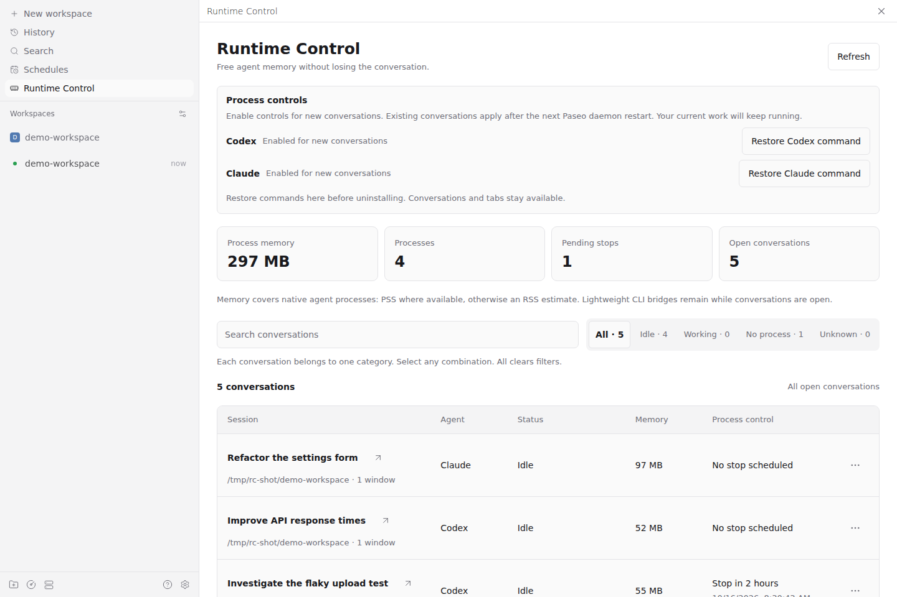

# Runtime Control for Paseo

**Free agent memory without losing the conversation.**

Stop an idle Codex or Claude process now, or schedule a stop after a chosen number of hours. Working agents wait until their work finishes. Conversations, history, and tabs stay available; sending another message resumes the same agent session.




## Install and enable

Requires **Paseo daemon and app 0.11.2**, with plugins enabled in the daemon configuration.

```sh
paseo plugin install github:babo-jeonguk/paseo-runtime-control
```

The plugin ID is `runtime-control`. A local checkout can also be installed with `paseo plugin install /absolute/path/to/paseo-runtime-control`.

Open **Runtime Control** in the sidebar header. Select **Enable Codex** and/or **Enable Claude**. This changes only that provider's launch command through Paseo's public configuration API. The plugin includes its own CLI bridges; no Paseo installation files or Claude settings files are patched.

New conversations use the controls immediately. Existing conversations keep their captured launch settings until the next natural **Paseo daemon restart**. The plugin never restarts the daemon or interrupts existing work to adopt it.

## Use

- **Stop process now** stops an idle native runtime. Active foreground work, permission requests, background tasks, goals, and scheduled activity defer it.
- **Stop process in…** starts a one-time deadline from save time. The default is **1 hour**, with 30 min/1/2/4/8-hour presets and custom 0.25–168 hours.
- **Cancel scheduled stop** leaves the current process running and never starts a stopped one.
- Open tabs across reporting windows/devices on one host form one list. Closing the last confirmed tab removes its row; process termination keeps it.
- Shared provider-subagent tabs retain their parent's row and count its runtime once.
- Filters find memory to free. Each conversation belongs to exactly one category by process and work status: **Idle**, **Working** (including background work), **No process**, or **Unknown**. Their counts sum to **All**. Selected categories combine with **OR**; **All** clears them and keeps the search text. Stop schedules appear under **Process control** and never change a conversation's category.
- The compact icon beside a title opens that conversation in Paseo.
- Disconnected windows retain their last reported tabs as **Sync pending**, without automatic expiry.

An empty Codex conversation becomes stoppable after its first completed message saves native history. Unknown process ownership disables termination. A never-started Claude session can remain **Status unavailable** until its first managed CLI launch; missing connection records are never treated as proof of no process.

## Compatibility and data

Validated on Linux with stock Paseo **0.11.2**, Codex **0.162.1**, and Claude **2.1.299**. Unknown native protocols/disabled Claude hooks keep normal messages usable but disable process control. Web tab reporting is verified with the stock production app. The read-only React/Fabric layout adapter is private and version-dependent; iOS/Android device validation is still required. When discovery fails, it preserves uncertainty instead of reporting an empty tab list.

Memory displays native process-tree PSS where available, with RSS estimates otherwise. The lightweight bridge remains resident. Native full-JSON parsing can create temporary peaks; the standalone bridge collects released history allocations after stopping, without changing daemon/app GC settings.

Long Codex history is replayed from private encrypted temporary files: memory-only AES-256-GCM keys, authenticated chunks and a complete manifest. Defaults are 256 MiB per artifact and 512 MiB per bridge. Storage/verification failure keeps native running. Resume/normal exit remove owned files; a later launch conservatively removes proven-dead owners' encrypted files. Uncertain or replaced files are preserved. This isolates OS users; it does not defend against malicious code already running as your OS user.

## Restore and uninstall

Use **Restore Codex command** / **Restore Claude command** before uninstalling. Custom argv is restored exactly; an originally default command becomes explicit `["codex"]` or `["claude"]`, because Paseo cannot delete just that override. Observed later user command changes are preserved. Public configuration has no compare-and-swap, so simultaneous edits of the same field can still race.

If removal happens before restoration, retained private launchers forward new sessions to the original CLI without a session recipe. Existing bridge-backed sessions also remain usable. These small immutable assets and ownership receipts are deliberately retained because captured sessions/configuration may still refer to them. Do not delete their plugin-data directory while a launch command or existing session still uses it.

## Roadmap

Paseo does not yet offer public APIs for discovering open tabs, stopping a conversation's provider process, or restoring a stopped process when the next message arrives. The CLI bridges and the read-only tab adapter fill those gaps. When Paseo supports these capabilities, Runtime Control will replace the corresponding implementation with the official APIs.

## Development

```sh
npm ci
npm run build:runtime
npm run check
```

`server/runtime-assets.generated.ts` bundles the Node-only bridge sources in `server/runtime/`. Rebuild it with `npm run build:runtime` after changing those sources; `npm run check` fails when the committed bundle no longer matches them. Paseo installs from Git without running a build, so the generated file is committed. There are no runtime downloads.
