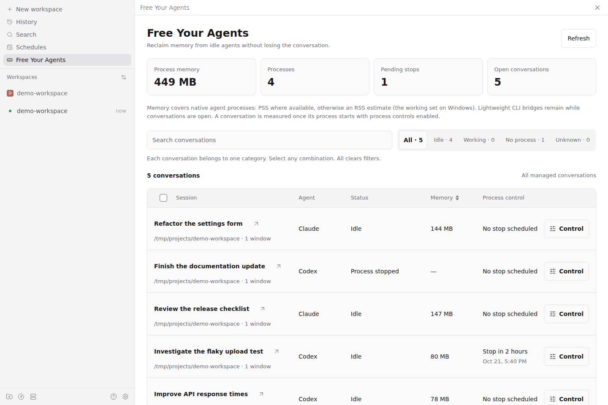
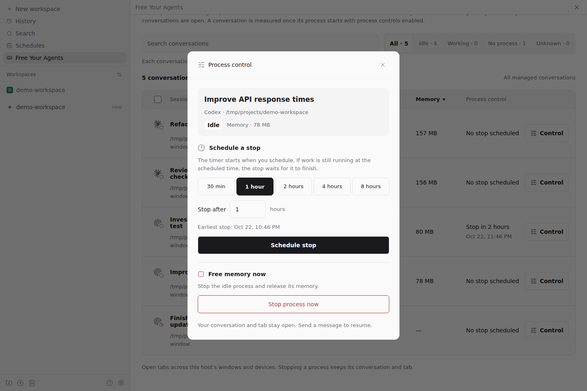
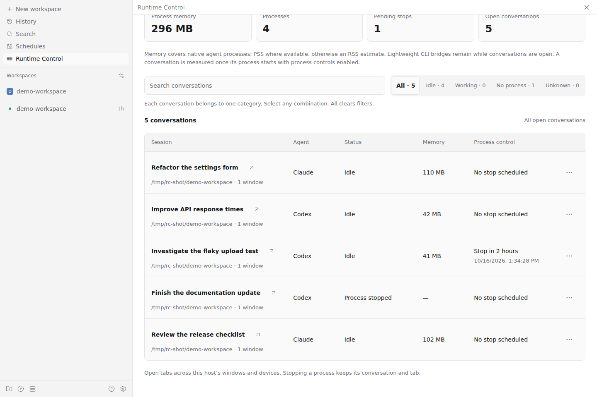

# Free Your Agents for Paseo

Free Your Agents shows how much memory your open Codex and Claude conversations use in Paseo, and stops idle agent processes now or at a time you choose. The conversation, its history and its tab stay open. Your next message starts the process again and resumes the same session.

It helps when many conversations stay open: each one keeps its CLI process running even while idle, and those processes add up.



*Process memory totals, status filters and managed conversation tabs on the host.*

## What you can do

- **See where memory goes.** Managed conversation tabs across the windows and devices connected to the host, with their provider, status and process memory, plus totals. Sort by memory to find the largest.
- **Find what you can free.** Filter by **Idle**, **Working**, **No process** or **Unknown**, or search by title and workspace.
- **Stop now or later.** Stop an idle process immediately, or schedule a one-time stop for one conversation (1 hour by default, from 15 minutes to 7 days).
- **Let work finish first.** A stop waits while the agent is responding, waiting for permission, or running background tasks, goals or scheduled activity.
- **Pick up where you left off.** Send a message and the same session continues.

## Requirements

- **Daemon host:** Linux or Windows. On macOS the screen loads, but process controls are unavailable.
- **Paseo:** v0.11 or later, with plugins enabled.
- **Agent CLIs:** process control is validated with Codex v0.162.1 and v0.163.0, and Claude v2.1.299 and v2.1.301. With other versions, conversations work normally but process control stays off.
- **Windows:** Claude needs Node.js on `PATH`, because Paseo starts Claude without a shell.
- **Apps:** tested in Paseo's web app. Native iOS and Android apps are not validated yet.

## Install and start

```sh
paseo plugin install github:babo-jeonguk/paseo-free-your-agents
```

You can also paste the source into **Settings → Plugins → Plugin source**. Plugins must be enabled: **Settings → Plugins → Enable plugins**, or `"pluginsEnabled": true` in the daemon's `config.json`.

When the plugin first runs, it turns on process control for Codex and Claude. This changes one setting per provider, its launch command, so that conversations start through a small bridge (see [How it works](#how-it-works-and-data-access)). To leave a provider unchanged, turn its switch off in **Settings → Plugins → free-your-agents → Settings**. It stays off.

- **New conversations** use process control right away.
- **Conversations that were already open** keep their previous launch settings until the next Paseo daemon restart. Until then they show **Status unavailable**.

Restart the Paseo daemon after installing so that open conversations get process control too: use **Restart daemon** in the host's settings, or run `paseo daemon restart`. Choose a moment when no agent is working. The plugin never restarts the daemon itself.

Updates work the same way. New conversations use the updated version right away; open ones keep the previous version until the daemon restarts.

To check that it works, start a new conversation and wait for the first reply. Then open **Free Your Agents** from the sidebar. The conversation shows **Idle** with its memory.

## Use

Click **Control** on a conversation to stop it now, or to schedule, update or cancel a stop. A busy agent offers **Stop when finished…** instead.



After a stop, the conversation and its tab stay open, and its status becomes **Process stopped**. Send a message to resume the same session.



Each conversation has exactly one status, so the status counts add up to **All**. Filters combine with OR.

Only conversations opened as tabs are managed. Mobile sheets are excluded. Conversations in background workspaces are excluded by default; turn on **Include background conversations** in **Settings → Plugins → free-your-agents → Settings** to include their open tabs. This setting applies to every window and device connected to that host. Turning it off removes those conversations from the list and totals and cancels their pending stops. Turning it back on does not restore cancelled stops. Background tasks inside an ordinary conversation still keep its process protected.

## How it works and data access

Paseo v0.11 has no public plugin API to release an idle provider process without archiving the conversation. Free Your Agents fills that gap:

- **Launch command.** Turning a provider on points its launch command at a small Node bridge, through Paseo's public configuration API. Profiles that extend `codex` or `claude` without their own command use it too. Paseo's installation files and Claude's settings are not modified.
- **Bridge.** The bridge (about 20 MB) stays running after a stop to keep the conversation connected. It is not counted in the process totals.
- **Memory.** On Linux, the native process tree's PSS, or an RSS estimate when PSS is unavailable. On Windows, its working set. The two are not directly comparable.
- **What it reads.** Conversation titles, providers and workspaces through Paseo's API; open tab IDs from the Paseo app windows; process memory from the operating system. Open tabs are read through a read-only adapter for the app's internals until Paseo offers a public API.
- **What it stores.** Management settings, schedules, open-tab lists and the original launch commands in the plugin's `plugin-data` directory. After a stop, long Codex histories are replayed from temporary files encrypted with a key kept only in the bridge's memory, and deleted on resume or exit. On Windows, Paseo force-closes a conversation's processes when it is archived; the next Codex conversation then deletes its unreadable files.
- **Network.** The plugin makes no network requests of its own. The bridge talks to Paseo and the agent CLIs over local sockets or named pipes; the CLIs reach their providers as usual.
- **Safety.** When the plugin cannot confirm that it owns a process, or does not recognize a CLI's protocol, it never stops that process.

## Troubleshooting

- **An existing conversation shows Status unavailable.** It was open before the plugin was installed. Restart the Paseo daemon to give it process control.
- **Process control turned off after a CLI update.** That CLI version is not validated yet. Conversations keep working; stopping stays off until it is.
- **A total shows `296+ MB`.** Some conversations are not measured yet. The number is the sum of the measured ones.
- **A stop does not happen right away.** The agent is busy. The stop waits until its work finishes.
- **Some memory remains after a stop.** The bridge stays running and is not part of the totals.
- **Tabs show Sync pending.** A window reporting them disconnected. They stay listed until it reconnects.
- **A new conversation cannot be stopped yet.** It becomes stoppable once its first message completes.

## Turn off and uninstall

1. Turn off **Codex** and **Claude** in the plugin's Settings. This restores their original launch commands. A provider that had no custom command gets an explicit `["codex"]` or `["claude"]`, because Paseo's configuration API cannot remove an override.
2. Uninstall the plugin.

If you uninstall first, the launchers left in the plugin's `plugin-data` directory pass new sessions straight to the native CLI. Do not delete that directory while a provider command still points into it.

## Development

```sh
npm ci
npm run build:runtime   # after editing server/runtime/
npm run check           # bundle check, typecheck and tests
```

Paseo installs Git plugins without a build step, so the bridge scripts are bundled into the committed `server/runtime-assets.generated.ts`. `npm run check` verifies it matches its sources.

## License

[MIT](LICENSE). See [`THIRD_PARTY_NOTICES.md`](THIRD_PARTY_NOTICES.md) for third-party notices.
